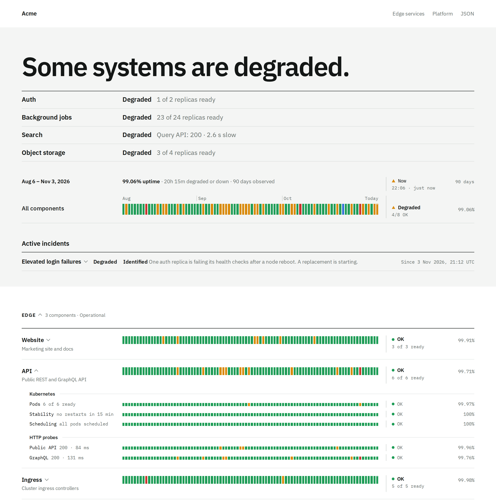

# sutats

A status page for things running on Kubernetes.

It watches Deployments, StatefulSets and DaemonSets and turns the ones you
annotate into components on a public page. Each component shows live health
from its pods, Services, Ingresses and HTTP probes, a 90-day uptime bar and any
incidents or maintenance windows you have posted. It needs no agents and no
database: it reads the cluster through the API server and keeps uptime history
in a ConfigMap or a file, or in TimescaleDB if you want minute-level detail.

<picture>
  <source media="(prefers-color-scheme: dark)" srcset="docs/screenshot-dark.png">
  
</picture>

**Contents:**
[Adding workloads](#how-to-add-workloads) ·
[Checks](#configuring-the-checks) ·
[HTTP probes](#http-probes) ·
[Pages](#pages-one-deployment-many-status-pages) ·
[Incidents](#incidents-and-maintenance) ·
[Deploy](#deploy) ·
[Run locally](#run-locally) ·
[Flags](#flags) ·
[HTTP endpoints](#http-endpoints) ·
[Uptime history](#uptime-history)

## How to add workloads

Add these annotations to a Deployment, StatefulSet or DaemonSet:

| Annotation                | Meaning                                              |
| ------------------------- | ---------------------------------------------------- |
| `sutats.io/component`     | Required. Display name. Opts the workload in.        |
| `sutats.io/group`         | Heading to list it under (for example `Edge`).       |
| `sutats.io/description`   | One line shown under the name.                       |
| `sutats.io/order`         | Integer sort key. Lower numbers come first.          |
| `sutats.io/maintenance`   | `"true"` forces "Under maintenance".                 |
| `sutats.io/hide`          | `"true"` hides it when running with `--all-workloads`. |

```yaml
metadata:
  annotations:
    sutats.io/component: "API"
    sutats.io/group: "Edge"
    sutats.io/description: "Public REST API"
```

See `examples/annotated-workloads.yaml` for a full set.

### How status is decided

| Cluster state                                   | Status            |
| ----------------------------------------------- | ----------------- |
| All desired replicas ready                      | Operational       |
| Some, but not all, replicas ready               | Degraded          |
| Rollout stuck (`ProgressDeadlineExceeded`)      | Degraded          |
| No replicas ready                               | Outage            |
| Scaled to zero, or `sutats.io/maintenance: true` | Under maintenance |

Around each workload, sutats also reads the objects related to it. These show
under the component and feed its status the same way:

| Row         | Read from                     | Degraded when                                   | Outage when                                 |
| ----------- | ----------------------------- | ----------------------------------------------- | ------------------------------------------- |
| Pods        | the workload                  | some replicas ready (with the pods' reason)     | none ready                                  |
| Stability   | Pods                          | a crash loop, an OOM kill or a restart in the last 15 min (more than `tolerate`) | every pod crash-looping |
| Scheduling  | Pods                          | a pod unschedulable, or an image that cannot be pulled |                                      |
| Endpoints   | Services and EndpointSlices   | a Service has fewer ready endpoints than `min` (default 1) | a matching Service has no ready endpoints while pods are ready |
| Ingress ... | Ingresses                     | no load balancer address                        |                                             |
| Route ...   | OpenShift Routes              |                                                 | not admitted by the router                  |
| TLS ...     | hosts of those Ingresses and Routes, plus `hosts=` | the certificate expires within `warn` (default 7 days) | the certificate has expired |

Services are matched by selector against the workload's pod labels;
Ingresses and Routes by the Services they point at. A TLS host that cannot
be reached shows as Unknown rather than as a failure; the HTTP probes cover
reachability.

### Configuring the checks

Each check is configured with one value: a mode, settings, or both.

```yaml
metadata:
  annotations:
    sutats.io/check.stability: "info window=1h"   # queue workers restart between jobs
    sutats.io/check.tls: "warn=21d hosts=shop.example.com"
    sutats.io/check.endpoints: "min=2"
    sutats.io/check.scheduling: "off"
```

The same value can be set in three places. A later place wins, per check and
per setting:

1. A flag, the default for the whole cluster: `--check.tls="warn=14d"`, or the
   environment variable `SUTATS_CHECK_TLS`.
2. An annotation on a Namespace, for every workload in it.
3. An annotation on the workload.

So a namespace can say `sutats.io/check.tls: "off"` and one workload in it can
say `sutats.io/check.tls: "on"` to bring the check back. It keeps any
settings, such as `warn`, from the flag.

The modes say how much a check counts:

| Mode       | The row       | What it does to the component                  |
| ---------- | ------------- | ---------------------------------------------- |
| `on`       | shown         | counts as the check reports it (the default)   |
| `info`     | shown         | never counts; its downtime does not open the rows either |
| `degraded` | shown         | counts, but an outage only degrades the component |
| `outage`   | shown         | counts, and anything degraded is an outage     |
| `off`      | not shown     | the check does not run                         |

A failing row whose mode changed what it counts as says so, for example
"3 restarts in 1 h · not counted". The row's own bar always shows what the
check saw. The component's bar and uptime follow what it counted as.

The checks and their settings:

| Check        | Settings |
| ------------ | -------- |
| `pods`       | none. It cannot be turned off, since the component is built on it; use `info` to stop it counting. |
| `stability`  | `window=30m`: how far back restarts count, 1 minute to 1 day, default 15m. `tolerate=2`: restarts allowed in the window before it is degraded, default 0. A crash loop is never tolerated. |
| `scheduling` | none |
| `endpoints`  | `min=2`: ready endpoints each Service needs, default 1. |
| `ingress`    | none. Turning it off hides the Ingress and Route rows, but their hosts still feed the TLS check. |
| `tls`        | `warn=14d`: how close to expiry is degraded, default 7d. `hosts=a.example.com,b.example.com`: hosts to check besides those found on Ingresses and Routes, such as a host served by a proxy outside the cluster. |
| `http`       | none. `off` stops the declared probes from running. |

Durations take `m`, `h` or `d`, such as `30m` or `14d`. A list has commas and
no spaces.

When several Services select the same pods, such as a headless one beside the
normal one, name the ones that matter on the workload. Only these then count
for the endpoint check and for finding Ingresses and Routes:

```yaml
sutats.io/services: "api, api-admin"
```

To see what is in force for a component, look at its `checks` field in
`/api/v1/components`, with `--show-internals` set.

An active incident raises a component to at least the incident's impact. An
active maintenance window sets it to Under maintenance regardless of what the
cluster reports, and that time is not counted as downtime.

The headline is the worst status of any component.

## HTTP probes

Replica counts only say the pods passed their readiness probes. To check that
the application actually answers, give the workload one or more URLs to probe.
Each probe gets its own row under the component, in an "HTTP probes"
section, with its latest result and its own 90-day bar. A failing probe
changes the component status just like missing replicas would.

**One URL**

```yaml
sutats.io/probe: https://api.example.com/healthz
```

**Several URLs, named by the key suffix**

```yaml
sutats.io/probe.public-api: https://api.example.com/healthz
sutats.io/probe.graphql:    https://api.example.com/graphql?query=%7B__typename%7D
sutats.io/probe.internal:   http://api.prod.svc:8080/readyz
```

The suffix becomes the label, so `public-api` shows as "Public api".

**Full settings, as a YAML list in one annotation**

```yaml
sutats.io/probes: |
  - name: Public API
    url: https://api.example.com/healthz
  - name: GraphQL
    url: https://api.example.com/graphql
    method: POST
    headers:
      Content-Type: application/json
    expect_status: 200        # default: any 2xx
    expect_body: '"data"'     # substring that must appear in the body
    timeout: 5s               # default 5s
    degraded_after: 800ms     # default 2s; off disables it
    insecure: true            # skip TLS verification
```

The forms can be combined. Probes run every sampling interval (15 seconds by
default), in parallel, each with its own timeout.

| Result                                        | Probe status                |
| --------------------------------------------- | --------------------------- |
| Expected status within `degraded_after`       | Operational                 |
| Expected status but slower than `degraded_after` | Degraded                 |
| Wrong status, body mismatch, timeout or connection error, 3 times in a row | Outage |
| 1 or 2 failures in a row                      | Previous status kept, with the failure shown on the probe's row |

A probe that has never succeeded shows as Unknown until it either succeeds or
fails three times, so a freshly deployed broken endpoint is not hidden.

The component status is the worst of its replica check and all its probes.

Probe the public URL where you can. That also catches DNS, TLS, ingress and
load balancer problems.

## Pages: one deployment, many status pages

One sutats instance serves any number of pages, each on its own hostname.
A page is defined by labelling namespaces, so rolling a page out to a new
team is one label in their namespace manifest and nothing else.

```yaml
apiVersion: v1
kind: Namespace
metadata:
  name: payments-prod
  labels:
    sutats.io/page: payments            # this namespace's components go on the "payments" page
  annotations:
    sutats.io/page-title: "Payments"    # optional; defaults to the slug, capitalised
    sutats.io/page-host: status.pay.example.com   # optional; defaults to the --page-host template
    sutats.io/pages: "engineering"      # optional extra pages, comma separated
```

| Where       | Key                      | Meaning                                                     |
| ----------- | ------------------------ | ----------------------------------------------------------- |
| Namespace   | `sutats.io/page` (label) | Primary page slug. Lowercase letters, digits, hyphens.       |
| Namespace   | `sutats.io/pages`        | Extra page slugs, comma separated. A namespace can be on several pages. |
| Namespace   | `sutats.io/page-title`   | Title for the primary page.                                 |
| Namespace   | `sutats.io/page-host`    | Explicit host for the primary page.                         |
| Workload    | `sutats.io/pages`        | Extra pages for just this workload, on top of its namespace's. |

Hosts come from the `--page-host` template, for example
`--page-host={slug}.status.example.com`, so the page above is served at
`payments.status.example.com`. The bare host (`--host=status.example.com`)
serves the default page with every component on it, and links to all pages.
Each page links back to the default and to its siblings.

Set up DNS and the Ingress for the bare host plus a wildcard
(`*.status.example.com`); `deploy/base/sutats.yaml` shows both rules.

Page discovery needs permission to list namespaces. Without it (for example
with per-namespace Roles and `--namespaces`), sutats logs a warning and serves
only the default page.

## Incidents and maintenance

Incidents live in ConfigMaps called
`sutats-incidents` under the key `incidents.yaml`. A ConfigMap with that name
in any namespace is picked up: teams keep theirs in their own namespace, and
an incident shows on the default page and on the pages that namespace
belongs to.

An incident can say where it appears instead, with `pages: [payments,
platform]`. The list replaces the namespace's pages, the default page
included: add `default` to keep it there, or use `pages: ["*"]` for every
page. For a cluster-wide announcement, such as one kept in the sutats
namespace, set `pages: ["*"]`; without it, an incident in a namespace that
is on no page shows on the default page only. Incidents read from
`--incidents-file` belong to no namespace and show on every page.

```yaml
incidents:
  - title: Elevated login failures
    impact: degraded          # none | maintenance | degraded | outage
    components: [Auth]        # display names; omit to affect everything
    updates:
      - at: 2026-10-15T08:12:00Z
        status: investigating # investigating | identified | monitoring | resolved
        body: Some sign-in attempts are returning errors.
      - at: 2026-10-15T09:20:00Z
        status: resolved
        body: Resolved.

  - title: Database storage upgrade
    components: [PostgreSQL]
    scheduled_for: 2026-10-20T01:00:00Z
    scheduled_until: 2026-10-20T03:00:00Z
    updates:
      - at: 2026-10-13T12:00:00Z
        status: scheduled
        body: Expect up to 10 minutes of read-only mode.
```

A `resolved` or `completed` update closes the incident and moves it to "Past
incidents", where it stays for 30 days. Entries with `scheduled_for` are
maintenance windows: listed under "Scheduled maintenance" until they start, then
active until `scheduled_until` passes or you post `completed`.

## Deploy

```bash
# Build and push the image (set IMAGE to your registry)
make image push IMAGE=registry.example.com/sutats

# Edit the image, host and ingress class in deploy/base/sutats.yaml, then:
kubectl apply -f deploy/base/sutats.yaml
```

That keeps uptime history in a ConfigMap. For minute-level history, change
the password (in both places) in `deploy/base/timescaledb.yaml` and apply the
whole base instead, which adds a single-node TimescaleDB:

```bash
make deploy              # kubectl apply -k deploy/base
```

The manifest creates a `sutats` namespace, a read-only ClusterRole for
workloads, namespaces and ConfigMaps, a namespace Role for writing the state
ConfigMaps and the leader Lease, a two-replica Deployment with a
PodDisruptionBudget, and a Service and Ingress with a wildcard rule for pages.

To limit it to specific namespaces, add `--namespaces=prod,edge` to the
container args. To show every workload without annotating anything, add
`--all-workloads` (names become `namespace/workload`, grouped by namespace).

### OpenShift

`deploy/openshift` is a kustomize overlay that swaps the Ingress for Routes
(one per page host, since routers do not serve wildcards by default) and
drops the UID and fsGroup settings the restricted SCC assigns itself. With
`oc login` done:

```bash
make openshift-deploy    # oc apply -k deploy/openshift, pulls the CI image
make openshift-demo      # a "shop" namespace with real probed workloads
```

Edit the hosts in `deploy/openshift/routes.yaml` and the args patch in
`deploy/openshift/kustomization.yaml` for your cluster's apps domain. To
run a locally built image instead, `make openshift-image` pushes one to the
cluster's internal registry; the overlay's comments say how to point at it.

## Run locally

```bash
# Against the cluster in your current kubeconfig context
make run

# With fake data, no cluster needed
make mock
```

Then open http://localhost:8080.

## Flags

Most flags also have an environment variable.

| Flag                     | Env                          | Default                      |
| ------------------------ | ---------------------------- | ---------------------------- |
| `--listen`               | `SUTATS_LISTEN`              | `:8080`                      |
| `--title`                | `SUTATS_TITLE`               | `Status`                     |
| `--kubeconfig`           | `KUBECONFIG`                 | in-cluster, then `~/.kube/config` |
| `--namespaces`           | `SUTATS_NAMESPACES`          | all                          |
| `--all-workloads`        | `SUTATS_ALL_WORKLOADS`       | `false`                      |
| `--incidents-configmap`  | `SUTATS_INCIDENTS_CONFIGMAP` | `sutats-incidents` (name, looked for in every namespace) |
| `--host`                 | `SUTATS_HOST`                | unset (no link back from pages) |
| `--page-host`            | `SUTATS_PAGE_HOST`           | unset (pages need `sutats.io/page-host`) |
| `--incidents-file`       | `SUTATS_INCIDENTS_FILE`      | unset (use the ConfigMap)    |
| `--history`              | `SUTATS_HISTORY`             | `auto` (database if `DATABASE_URL`, else configmap in-cluster, else file) |
| `--database-url`         | `DATABASE_URL`               | unset                        |
| `--data-dir`             | `SUTATS_DATA_DIR`            | `/data` (file mode)          |
| `--state-namespace`      | `POD_NAMESPACE`              | the pod's own namespace (where the state ConfigMaps and the Lease go) |
| `--leader-election`      |                              | `true`                       |
| `--interval`             |                              | `15s`                        |
| `--probe-parallel`       |                              | `16`                         |
| `--check.<name>`         | `SUTATS_CHECK_<NAME>`        | unset (see [Configuring the checks](#configuring-the-checks)) |
| `--show-internals`       | `SUTATS_SHOW_INTERNALS`      | `false` (see [HTTP endpoints](#http-endpoints)) |
| `--mock`                 | `SUTATS_MOCK`                | `false`                      |
| `--debug`                | `SUTATS_DEBUG`               | `false`                      |
| `--seed-history`         |                              | `0`. One-shot: write N days of invented history into the database, then exit (demo and trial installs only) |
| `--version`              |                              | Print the version and exit   |

## HTTP endpoints

| Path                  | What it returns                                        |
| --------------------- | ------------------------------------------------------ |
| `/`                   | The status page.                                       |
| `/api/v1/status`      | Everything on the page as JSON.                        |
| `/api/v1/components`  | Just the component list as JSON.                       |
| `/api/v1/series`      | Fine-grained history for one key (database mode only). `?key=<component id or id::signal>` plus either `&hours=24` or `&from=2026-10-16[&to=2026-10-17]` (dates are UTC midnight, `to` is exclusive), and `&bucket=1m` from 15s to 24h. |
| `/healthz`            | `ok` while the process is up.                          |
| `/readyz`             | `ok` once the cluster caches have synced, else 503.    |
| `/favicon.svg`        | Three bar cells in the current overall colour.         |

A status page is usually public, so by default the page and the API show
component names and states but not the cluster behind them. They leave out
namespaces, workload kinds and names, Service, Ingress and Route names,
scheduler and router messages, configuration mistakes and the check settings
in force. Components get IDs made from their display names, such as `api`,
and `/api/v1/series` accepts only the keys of bars on the page it is asked
from. For a page only visible inside your network, run with
`--show-internals` to see everything.


## Uptime history

Every 15 seconds the effective status of each component and each of its
signals is recorded into a per-day bucket. A day's bar colour is the worst
status that lasted any time that day (a workload caught mid-startup on its
very first sample does not colour the day). The uptime percentage is the share of observed time the
component was neither degraded nor down over the last 90 days. Time under
maintenance counts as up, not as downtime.

A sample just after midnight splits its time between the two days.

The "All components" bar and each group's bar are recorded the same way, as
rows of their own: at every sample, their status is the worst of their
members', so their downtime is the time anything in them was wrong, even when
members failed at different times. Days from before v1.1.0, which did not
record these rows, fall back to the longest downtime of any one member.

Where history lives depends on `--history`:

- `database` (the default when `DATABASE_URL` is set): TimescaleDB. Every
  sample is a row in a `samples` hypertable (status, seconds attributed,
  probe latency), compressed after 1 day and dropped after 100. Day buckets
  for the bars come from a continuous aggregate, `samples_daily`. Latest
  probe results sit in `probe_state`. This is the only mode that keeps
  minute-level detail, exposed at `/api/v1/series`. Any Postgres with the
  timescaledb extension works; `deploy/base/timescaledb.yaml` is a single-node
  starter. The schema is created on startup.
- `configmap` (the default in-cluster without a database): a gzipped ConfigMap called
  `sutats-history` in the sutats namespace, written once a minute. Ninety
  days for a few hundred signals is tens of kilobytes. Latest probe results go
  in a second small ConfigMap, `sutats-live`, every tick. Both are readable
  with `kubectl -n sutats get cm`.
- `file` (the default outside a cluster): `history.json` in `--data-dir`,
  saved once a minute and on shutdown. Empty `--data-dir` keeps it in memory.

